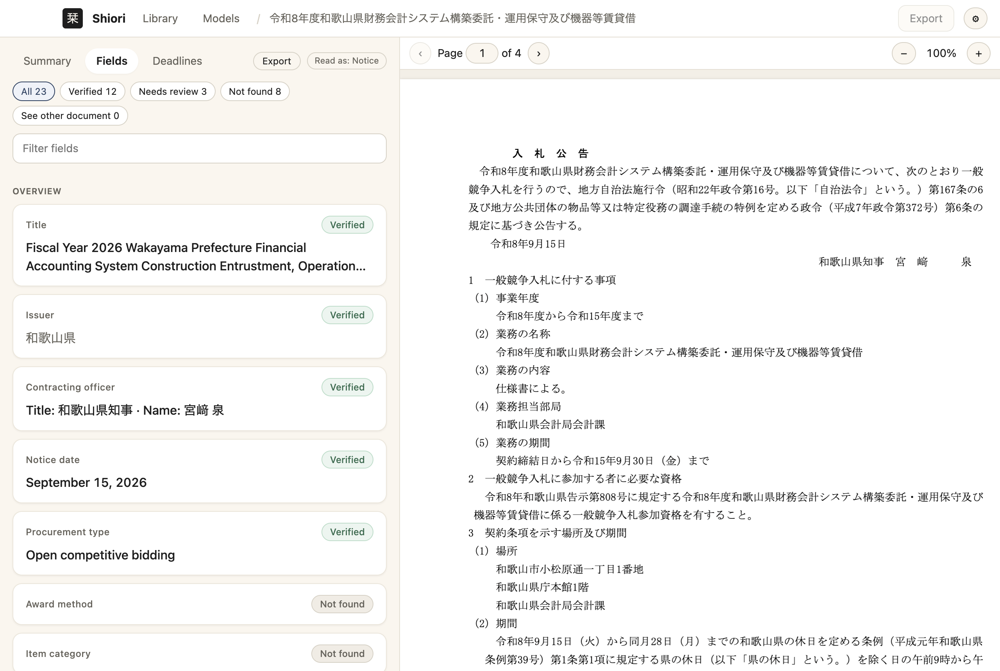
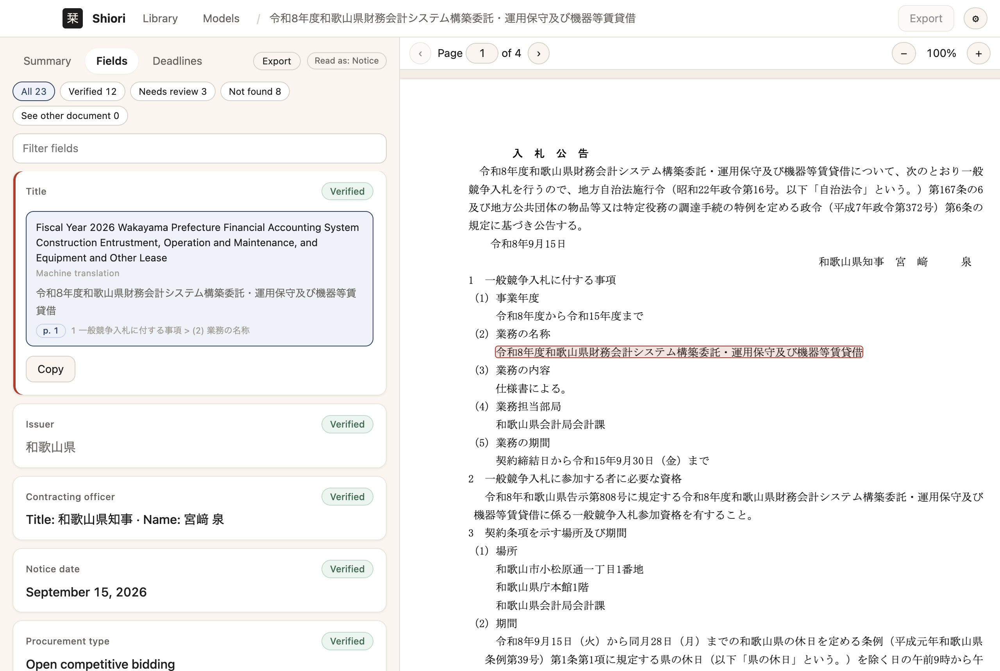
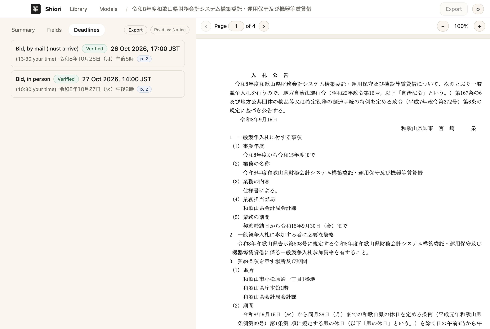

# Shiori (栞)

**Drop in a Japanese tender. Get the answer, with receipts.**

Japanese public tenders are long, dense and written in official-document Japanese. Shiori is a desktop app that reads one for you on your own computer and shows, in English, the things you need before you bid: the title, who issued it, the deadlines, who may bid, which documents to send, and so on. Every value points at the sentence it came from. Click it and the PDF opens on that page with the source sentence highlighted, so you can check it against the original.

> Early work in progress. There is no installer yet. You can run it from source (see below).

## Demo video

[](https://youtu.be/NeasBmbAPtA)

<sub>35 seconds of the desktop app on one public tender (Wakayama Prefecture): open a document, see the fields in English, click one to jump to its source sentence, and search the document when a field is not found. [Watch on YouTube](https://youtu.be/NeasBmbAPtA).</sub>

## Screenshots

Real screenshots of the current app, taken with Qwen3.5-9B on a MacBook Air M4. The document is the 2026 Wakayama Prefecture financial accounting system tender notice (4 pages), a public document used under the terms listed in "Sources and licenses" below. You do not need to read the Japanese on the right: the point is that each answer on the left maps to a sentence on the right.

**Fields.** Each of the 23 fields is Verified (the cited sentence was checked by code), Needs review, or Not found. The count chips at the top show all three groups for this run (12 Verified, 3 Needs review, 8 Not found). Not found is shown as an answer, not hidden.



**Citation click.** Clicking a value opens the PDF at its page and highlights the sentence it came from (red box, right). The panel shows the English line (marked "Machine translation"), the original Japanese sentence, the page, and the section path.



**Deadlines.** The dates found in the notice, each with its Japan time, your own time zone, the original Japanese wording and the page. (Export to CSV and a calendar file is a button in the app; it is not shown here.)



Source of the document in these screenshots: Wakayama Prefecture, tender notice (入札公告) for the 2026 financial accounting system, published at pref.wakayama.lg.jp under the Wakayama Prefecture website information terms of use (和歌山県ホームページ公開情報利用規約), which are compatible with CC BY 4.0. The screenshots are shown unmodified apart from file format.

## What it does

- **Every field has a receipt.** The model only points at numbered sentences. Code then checks that the value really appears in the sentences it cited. A value that fails the check is dropped instead of shown as a guess, and some checks (for example a heading that looks unusual for that field) downgrade Verified to Needs review (`CLAUDE.md`, `docs/architecture.md`, D-76).
- **Runs locally.** A small quantized model (Qwen3.5-9B by default) runs on your machine through llama.cpp. There is no cloud model and no upload in the app.
- **Built for Japanese documents.** Era dates (令和8年), 万/億 amounts, fiscal years and tax wording are handled by tested rules, not left to the model (`docs/japanese_rules.md`). Rules do what they can, and the model is used for the lists: eligibility, deadlines and required documents.
- **Hover to translate.** A sentence in the viewer can be translated to English on demand.
- **Export.** All fields go to a CSV file and the deadlines to a calendar (.ics) file, which you save yourself.

## Run it from source

You need: macOS (the only machine it has been run on), Python 3.12 with [uv](https://docs.astral.sh/uv/), Node 20 or newer, and `llama-server` from llama.cpp (for example `brew install llama.cpp`).

```
uv sync
cd app
npm install
npm run dev
```

The first time, no model is installed, so the app opens a Setup screen. Pick a model and click Download. It downloads the GGUF file (Qwen3.5-9B is about 5.7 GB) from a pinned Hugging Face address and checks its SHA-256 before using it; if the hash does not match, the file is deleted. That is the only time the app uses the internet. If you already have the file, "Choose a model file from disk" copies it in after the same hash check. Then click Add document and choose a tender PDF. In my runs of this one notice on an M4 Mac, the model job took 116 s and 190 s (two runs, not a benchmark).

Details: `app/electron/registry.ts` (models, URLs, hashes) and `docs/decisions.md` D-99 and D-100.

## Privacy: what the app does, what was measured, what was not

What the app does (`docs/privacy.md`, `docs/threat_model.md`): the document, its text and the results stay on your machine. The page that shows your document is not allowed to make any network request. The local services bind to 127.0.0.1 only, on a random port with a per-launch token. Logs hold event names, timings and counts, not document text.

What was measured:
- A counting request filter in the app cancels every request from the page except its own app address. A test runs it in a real Electron session and checks that a page's request to an outside host is cancelled (`tests/test_app_filter_electron.py`, D-100). In the screenshot runs above, the app reported 0 blocked requests.
- A network sample (2026-11-23, [`scripts/net_sample.py`](scripts/net_sample.py), result in `docs/privacy.md`): during one full extraction of the Wakayama notice above, every 2 seconds the script listed the internet sockets of the app, the sidecar and llama-server. 103 samples, no remote endpoint outside this machine, no socket listening on a non-loopback address, and the app's quit line said "renderer requests blocked: 0". This is a sample, not a packet capture, so a connection shorter than 2 seconds could be missed.
- A test scans the app code for network use and allows exactly one file, the model download (`tests/test_app_no_network.py`, `tests/test_security_static.py`).
- The model download is tested against a local fake server: a good hash installs, a bad hash deletes the file, an interrupted transfer resumes (`app/test/download.test.ts`). The three registry hashes and sizes were also compared with the hub's headers once (D-100).

What has not been done yet:
- A packet capture during a full session.
- A full real download of a model through the Setup screen (the tests use a fake server).
- The Wi-Fi-off demo run.
- The Windows 16 GB laptop run.
- Encrypted local storage and the user-visible network activity list from `docs/privacy.md` are designs, not built features (`docs/roadmap.md`).

## Status and limits

Read this before trusting any output.

- **Early.** There is no installer. It has been run from source on one Mac only.
- **The labels are silver.** The reference answers used for scoring were made by two models plus code checks, with a model reviewing the disagreements. A native Japanese reader has not checked them, so nothing is marked human-audited (`docs/eval_protocol.md`).
- **The test split has not been run.** All scores so far are on the 15 development documents, and the rules were tuned on them, so those scores are fits, not forecasts (D-96). One test document, 52bba5f9, is excluded from the planned test run because a rule was written after reading its title (D-102).
- **The one model-quality figure in the repo:** on the list fields (eligibility, deadlines, required documents) of the development documents, Qwen3.5-9B got 19 of 42 rows right and Gemma 4 E4B got 18 of 42, measured against the silver labels (D-74). That is a small, tuned-on set, so read it as a rough picture and not as an accuracy rate.
- **Speed:** the median was about 70 s per document, measured on 50 short tenders on an M4 Mac with Qwen3.5-9B (D-99; the report behind it is a local file, not in the repo). Slower machines and longer documents were not measured.
- **English lines for cited sentences are machine translation** by a small local model and can be wrong. Always check the Japanese sentence next to it. The app marks these lines "Machine translation".
- **Not every document type is covered.** It is built around tender notices and bid instructions. Specs and other types give fewer answers, and a field it cannot support with a verified sentence says Not found.
- Verified means the value was found in the cited sentence by code. It does not mean the answer is complete or that the document says what you need.

The corpus used for development is 519 public tender documents from 37 issuing organizations, 47 of them complete bundles (notice plus spec) (`data/manifests/corpus_report.md`). The documents are not in this repo.

## Support

If Shiori is useful to you, you can support it here: [Buy Me a Coffee](https://buymeacoffee.com/yashaarth/shiori-reading-japanese-tender-documents-english-sources).

## Help wanted

If you read Japanese, please try one example and tell me where the English or the highlighted sentence is wrong. Open an issue on this repo or message me on [LinkedIn](https://www.linkedin.com/in/yasharth-singh-b2493b284/). A native reader's check is the main thing missing.

## For developers

```
uv run pytest
uv run python -m eval.repo_scan
```

Docs: start with `docs/roadmap.md`, then `architecture.md`, `field_schema.md`, `japanese_rules.md`, `eval_protocol.md`, `privacy.md`, `decisions.md`.

## Sources and licenses

The open-license documents used here come from the Digital Agency, the Japan Meteorological Agency, the Government Procurement Portal (p-portal), Hokkaido, Wakayama Prefecture and Okayama Prefecture. They are published under the Public Data License 1.0 (PDL1.0), the Government Standard Terms of Use 2.0, or terms compatible with CC BY 4.0, which ask for the source to be named. Short sentences from them appear in tests and docs, and labels for some of them are in `data/eval/`, in some cases shortened or edited. Documents whose terms do not allow redistribution are used locally. Some short sentences from them remain in older commits of this repo (D-101), and they will be removed on request. Details in `docs/sources.md`.

A personal project by Yasharth Singh.
