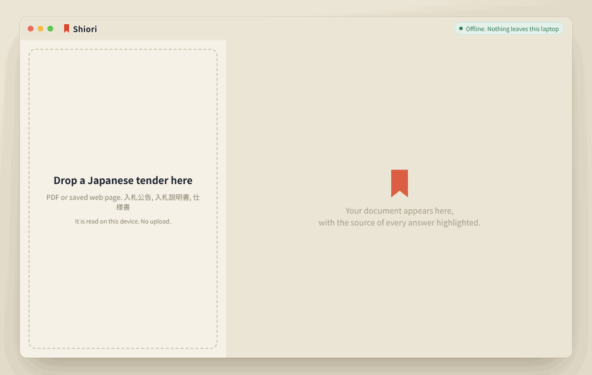
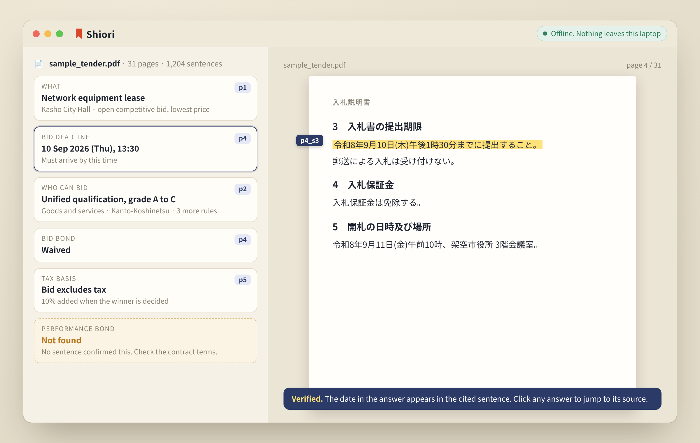
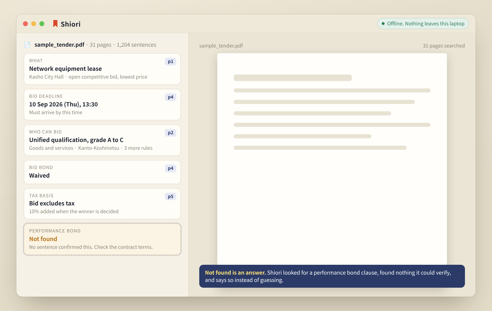

# Shiori (栞)

**Drop in a Japanese tender. Get the answer, with receipts.**

Japanese public tenders are long, dense and written in 公用文. Shiori is a desktop app that reads them for you, fully offline, and tells you in English what you need to know before you bid: when it closes, who can bid, what bonds apply, what the tax basis is, which documents to send. Every answer points at the exact sentence it came from. Click it and the PDF opens on that page with the source highlighted.

> Shiori is in development. The app below is the goal, not something you can download yet.

## What it will feel like



<sub>Concept mockup, not a screenshot. The tender and every value are invented.</sub>

<table>
<tr>
<td width="50%"></td>
<td width="50%"></td>
</tr>
<tr>
<td align="center"><sub><b>Every answer has a receipt.</b> Click it, land on the sentence.</sub></td>
<td align="center"><sub><b>Not found is an answer.</b> No verified sentence, no guess.</sub></td>
</tr>
</table>

- **Every field has a receipt.** The model only points at numbered sentences. Code checks the value really appears in what it cited, and anything that fails the check is shown as "not found" instead of a guess.
- **Nothing leaves your machine.** No cloud model, no upload, no telemetry. A small quantized model runs locally through llama.cpp, so you can feed it a tender you would never paste into a chatbot.
- **Built for how Japanese documents actually work.** Era dates (令和8年), 万/億 amounts, fiscal years, tax wording and "must not be a company that..." eligibility rules are handled by tested rules, not left to chance.
- **Hover to translate.** Any sentence in the viewer can be translated on demand, so you can read the source next to the answer.

## Where it is going

Targets from `docs/architecture.md`, to be validated, not results: a 30-page tender processed in under 90 seconds on a MacBook Air M4, under 4 minutes on a 16 GB Windows laptop with no GPU, under 8 GB of RAM in total.

After the first version, the roadmap lists:
- other document types (contracts, meeting minutes, emails)
- Korean and German on the same pipeline
- compare two tenders, draft a bid / no-bid checklist
- an MCP server so other local tools can query your document store

## How it works

```
PDF / HTML -> sentences with IDs, pages, boxes -> locate -> local model -> verify citations -> fields + summary
```

It is measured, not vibes. Every change is scored against a frozen eval set split by issuing organization, so the test set contains agencies the model has never seen. The shipped app makes no network requests, and a test fails if dev-only code (collector, eval, training, cloud SDKs) is imported into it.

## Right now

Done: a 519-document corpus of public tenders from 37 organizations (47 complete bundles), and an extractor that gives every sentence a stable ID, its page and boxes, with OCR for scans. In progress: the eval set, a 23-field schema with frozen splits and labels. Next: benchmark local models and pick the base. Then fine-tune, then build the app.

There is no model quality number yet, so none is claimed. The labels are silver: two models answer, code checks them, a model reviews the disagreements. Nothing is `human_audited` yet, because that needs a native speaker.

Local models that load in llama.cpp on the dev Mac (MacBook Air M4, a load check, not a quality result): LFM2.5-1.2B-JP 86.2 tok/s, LFM2.5-8B-A1B 68.3, Sarashina2.2-3B 35.3, Qwen3-Swallow-8B 18.5, Qwen3.5-9B 15.8, Nemotron Nano 9B JP 11.7.

## Try the dev tools

Python 3.12 with `uv`. These make no cloud call and start no model.

```
uv sync
uv run pytest                                              # 634 tests
uv run python -m eval.repo_scan                            # secrets, forbidden paths, restricted text
uv run python -m eval.silver daemon --gold --wave 1 --plan # what a gold labeling wave would do
uv run python -m eval.bakeoff --plan                       # local models x pilot documents, requests, estimated hours
```

Docs: start with `docs/roadmap.md`, then `architecture.md`, `field_schema.md`, `japanese_rules.md`, `eval_protocol.md`, `privacy.md`, `decisions.md`.

## Data and privacy

Collection and evaluation use public Japanese government tender documents only. Documents whose terms do not allow redistribution are used locally and never published. The app will keep your documents on your machine and never use them for training.

## Sources and licenses

The open-license documents used here come from the Digital Agency, the Japan Meteorological Agency, the Government Procurement Portal (p-portal), Hokkaido, Wakayama Prefecture and Okayama Prefecture. They are published under the Public Data License 1.0 (PDL1.0), the Government Standard Terms of Use 2.0, or terms compatible with CC BY 4.0, which ask for the source to be named. Short sentences from them appear in tests and docs, and labels for some of them are in `data/eval/`, in some cases shortened or edited. Source: the publishers named above. Details in `docs/sources.md`.

A personal project by Yasharth Singh.
